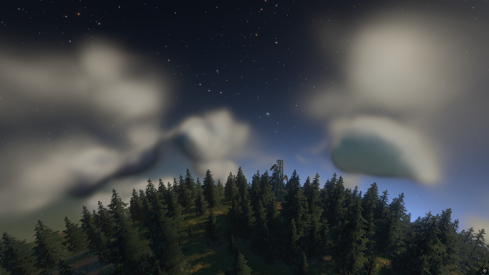
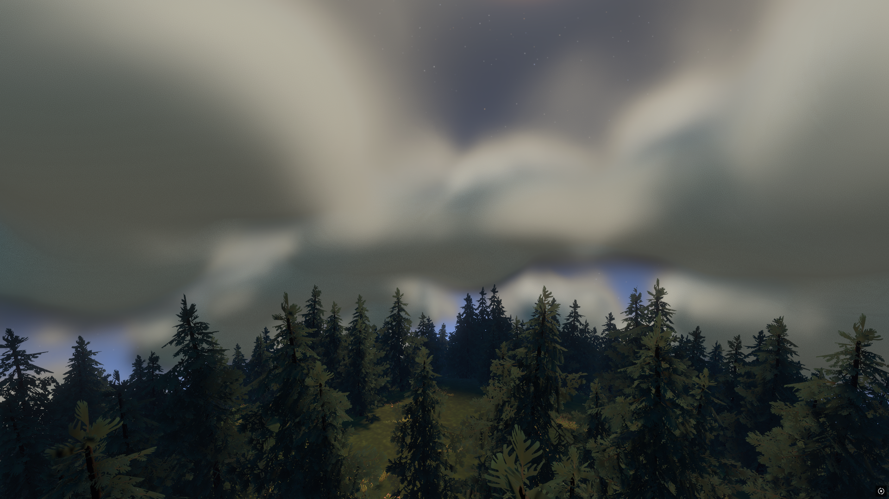
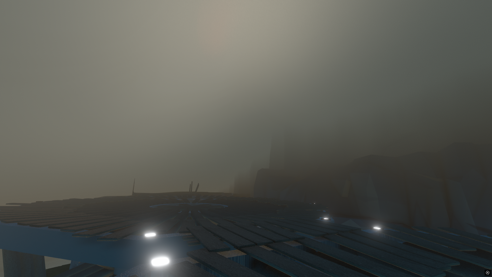
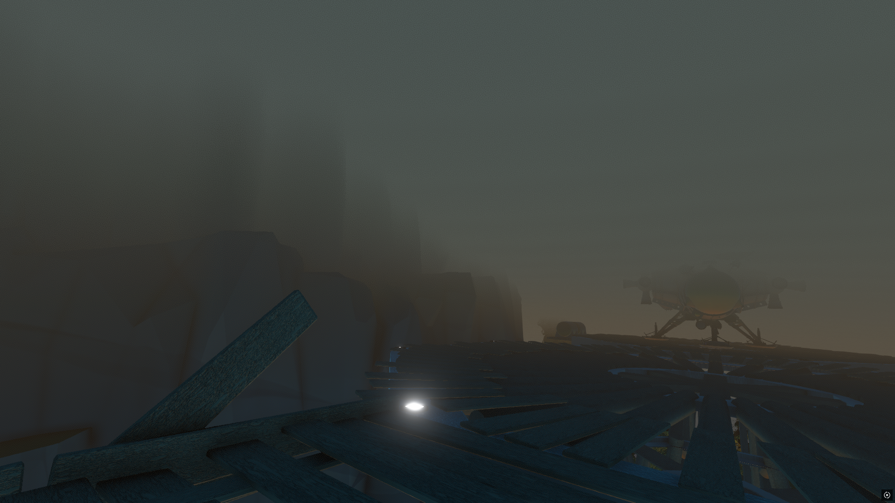
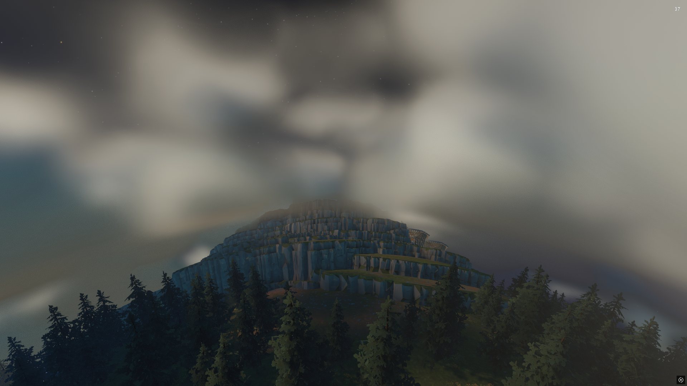
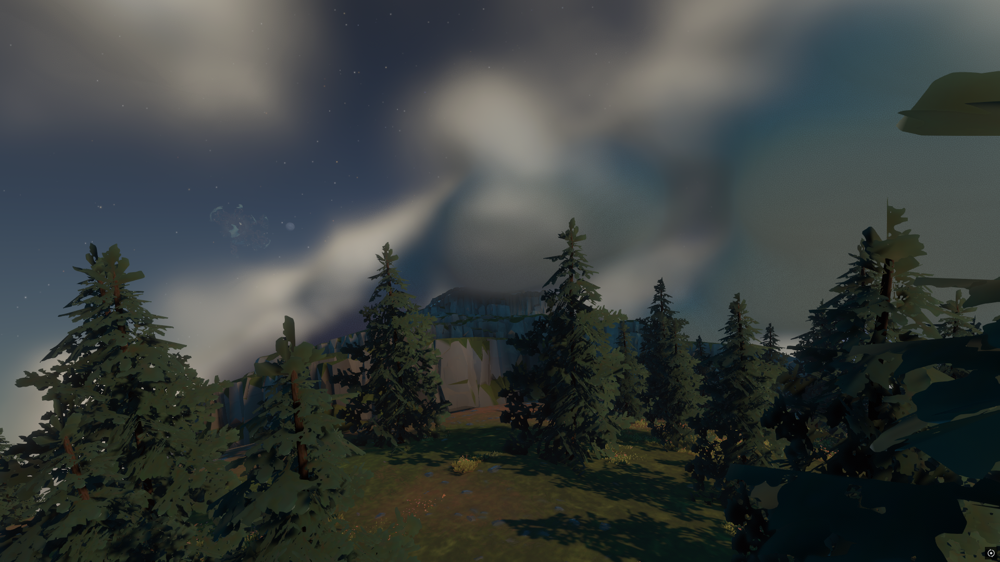
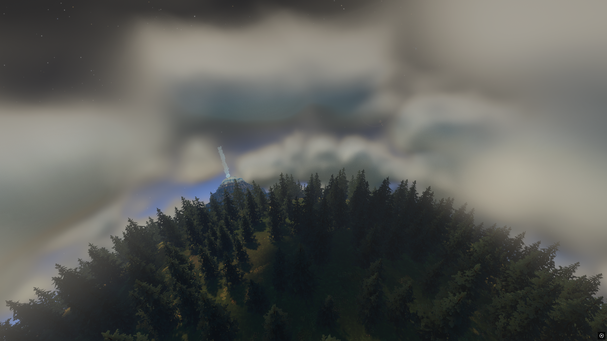
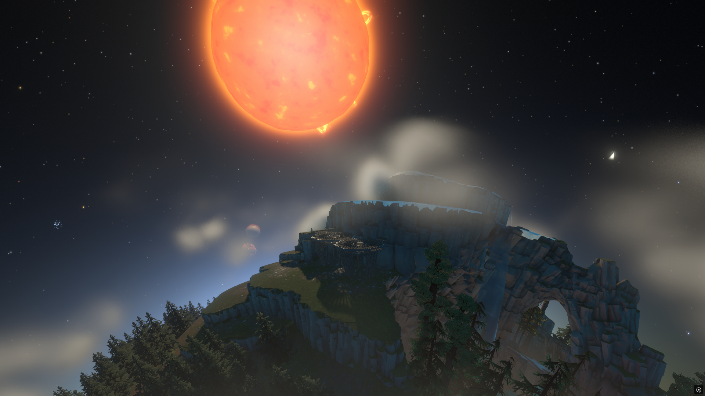
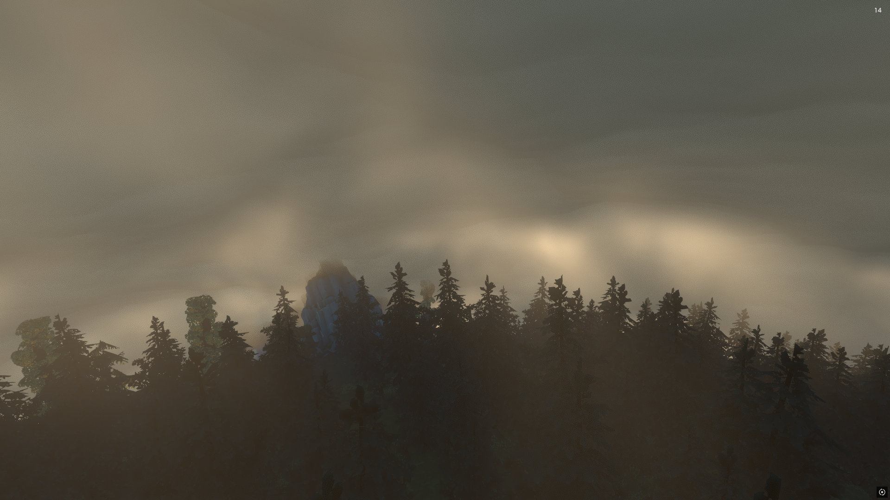
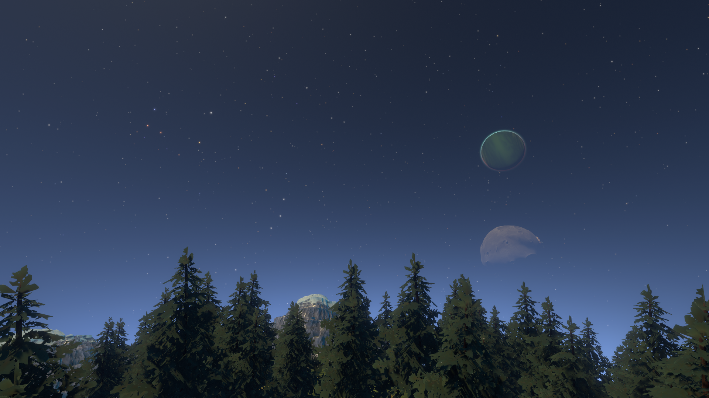

# Outer Wilds - Timber Hearth Forest

<hr>



<hr>

[](https://outerwildsmods.com/mods/timberhearthforest/)

## Info

This mod covers the barren surface of Timber Hearth with trees, grass, fireflies and a new geyser landing pad as well as adding clouds which can be either volumetric or plane (volumetric is a bit more computationally intensive but with the bonus of the clouds being 3D).

## Credits

- [JohnCorby](https://github.com/JohnCorby) - Ambient lighting, planet and moon shadows and cloud shadow implementation for volumetric clouds
- [GameDev46](https://github.com/GameDev46) - Timber Hearth trees, grass, fireflies, bird song, geyser landing pad, volumetric clouds and god rays implementation

## Installation

For the easiest method of installation, use the [Outer Wilds Mod Manager](https://outerwildsmods.com/mod-manager/)

## Settings

- The density of trees, grass, fireflies and clouds can be seperately customised
- Tree hitboxes can be toggled on or off (be careful when you turning hitboxes on, you don't want to be inside a tree when this happens!)
- Firefly timing can be changed to have them show during the day, night or day and night
- The bird song can be toggled on or off (when enabled bird song can be heard in some of the trees during the day)
- The new geyser landing pad on Timber Hearth can be toggled on or off
- The tree occlusion optimisation can be toggled on or off (when enabled this hides trees which are out of the camera's view helping to increase performance)
- ```[EXPERIMENTAL]``` Volumetric clouds can be toggled on or off (when off the default plane clouds are used)
- ```[EXPERIMENTAL]``` Volumetric cloud shadows can be enabled or disabled
- ```[EXPERIMENTAL]``` Dynamic clouds can be enabled or disabled (when enabled the volumetric cloud coverage, size and turbulence changes over time)
- ```[EXPERIMENTAL]``` The quality, size, sky coverage, turbulence and god ray quality of the volumetric clouds can be adjusted when not in dynamic mode (**WARNING**: god rays can impact performance significantly so I recommend leaving them off)

## Timber Hearth Forest API

To use the Timber Hearth Forest mod API, include this interface in your mod:

```csharp
public interface ITimberHearthForestAPI
{
    public bool GetSettingsLocked();
    public void SetSettingsLocked(bool locked);
    public bool GetTreeCollidersEnabled();
    public void SetTreeCollidersEnabled(bool enabled);
    public void SetRegularCloudDensityPreset(string cloudDensityPreset);
    public void SetTreeDensityPreset(string treeDensityPreset);
    public void SetGrassDensityPreset(string grassDensityPreset);
    public void SetFireflyDensityPreset(string fireflyDensityPreset);
    public void GetFireflyVisibilityAtNight();
    public void SetFireflyVisibilityAtNight(bool enabled);
    public bool GetFireflyVisibilityAtDay();
    public void SetFireflyVisibilityAtDay(bool enabled);
    public float GetTotalTreeCount();
    public float GetActiveTreeCount();
    public float GetTotalGrassCount();
    public float GetActiveGrassCount();
    public float GetTotalFireflyCount();
    public float GetActiveFireflyCount();
    public bool GetTreeOptimisationEnabled();
    public void SetTreeOptimisationEnabled(bool enabled);
    public void SetLandingPadEnabled(bool enabled);
    public void SetBirdSongVolume(float volume);
    public bool GetVolumetricCloudSettingsLocked();
    public void SetVolumetricCloudSettingsLocked(bool locked);
    public bool GetVolumetricCloudsEnabled();
    public void SetVolumetricCloudsEnabled(bool enabled);
    public float GetVolumetricCloudErosionStrength();
    public void SetVolumetricCloudErosionStrength(float strength);
    public float GetVolumetricCloudOuterRadius();
    public void SetVolumetricCloudOuterRadius(float radius);
    public float GetVolumetricCloudInnerRadius();
    public void SetVolumetricCloudInnerRadius(float radius);
    public float GetVolumetricCloudLightAbsorptionThroughCloud();
    public void SetVolumetricCloudLightAbsorptionThroughCloud(float absorption);
    public float GetVolumetricCloudLightAbsorptionTowardsSun();
    public void SetVolumetricCloudLightAbsorptionTowardsSun(float absorption);
    public bool GetVolumetricCloudShadowsEnabled();
    public void SetVolumetricCloudShadowsEnabled(bool enabled);
    public float GetVolumetricCloudScale();
    public void SetVolumetricCloudScale(float scale);
    public float GetVolumetricCloudCoverage();
    public void SetVolumetricCloudCoverage(float coverage);
    public float GetVolumetricCloudTurbulence();
    public void SetVolumetricCloudTurbulence(float turbulence);
    public bool GetDynamicWeatherEnabled();
    public void SetDynamicWeatherEnabled(bool enabled);
}
```

and then to use the the API in your class:

```csharp
var THForestAPI = ModHelper.Interaction.TryGetModApi<ITimberHearthForestAPI>("GameDev46.TimberHearthForest");
```

Remember to add the `GameDev46.TimberHearthForest` mod as a dependency in your mod's `manifest.json` file if your mod requires Timber Hearth Forest to work.

#### Quick Usage Notes

- `SetSettingsLocked()` and `SetVolumetricCloudSettingsLocked()` can be used to stop the player from changing settings in the Timber Hearth Forest mod settings menu.
- `SetRegularCloudDensityPreset`, `SetTreeDensityPreset`, `SetGrassDensityPreset` and `SetFireflyDensityPreset` can be used to set the density of the clouds, trees, grass and fireflies to either "Hidden", "Low", "Medium", "High" or "Ultra" (`SetRegularCloudDensityPreset` only goes to "High").
- `SetBirdSongVolume` can be used to set the volume of the bird song to a float value between 0 and 1 (where 0 is silent and 1 is full volume).

## Screenshots

<table>
  <tr>
    <th></th>
    <th></th>
  </tr>
  <tr>
    <th></t>
    <th></th>
  </tr>
  <tr>
    <th></th>
    <th></th>
  </tr>
  <tr>
    <th></th>
    <th></th>
  </tr>
  <tr>
    <th></th>
    <th></th>
  </tr>
</table>
